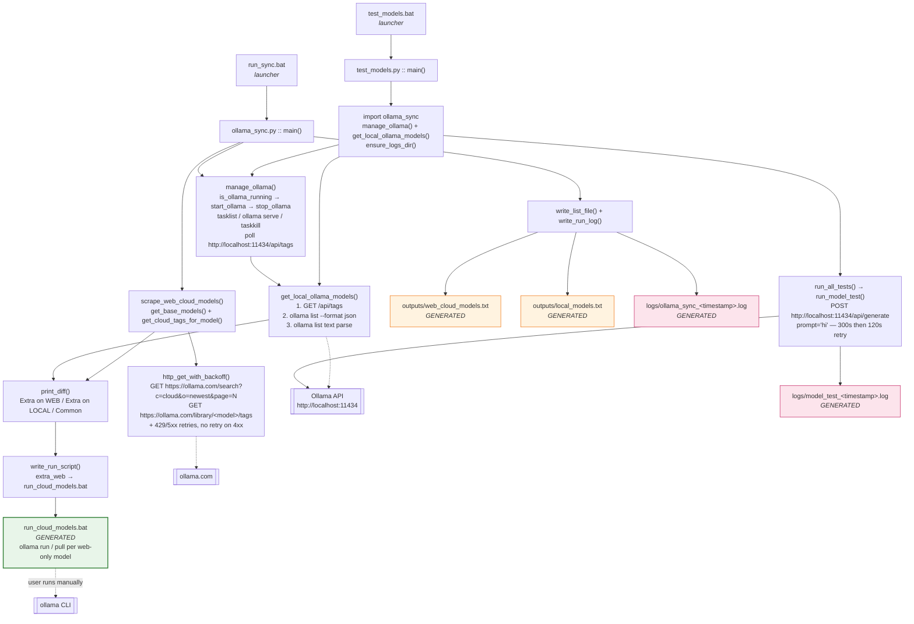

# Ollama Sync

Compare the `:cloud` models listed on [ollama.com](https://ollama.com/search?c=cloud&o=newest)
against the models installed locally on this PC, generate a run script for the web-only
models, and test which installed models actually work — with colour-coded ✓/✗/⚠ results
in the console and a timestamped log of every run.

## Files

| File | Purpose |
| --- | --- |
| `ollama_sync.py` | Main tool: manage Ollama, scrape web `:cloud` models, diff vs local, write log + run script. |
| `test_models.py` | Test every installed model with a `hi` prompt and classify it (functional / needs subscription / retired / not working / unavailable). Colored ✓/✗/⚠ output on the console. |
| `run_sync.bat` | Launcher for `ollama_sync.py` — checks Python/dependencies, runs it, lists the log files, and keeps the window open with a key-press (skipped when `CI` is set). |
| `test_models.bat` | Launcher for `test_models.py` — same checks, runs it, lists the log files, and keeps the window open with a key-press (skipped when `CI` is set). |
| `run_cloud_models.bat` | Generated — one `ollama run <model>` (or `ollama pull` with `--pull-only`) per web-only model. |
| `outputs/web_cloud_models.txt` | Generated — deduplicated sorted list of web `:cloud` models. |
| `outputs/local_models.txt` | Generated — sorted list of local models from `ollama list`. |
| `requirements.txt` | Runtime dependencies (`requests`, `beautifulsoup4`). |
| `requirements-dev.txt` | Development dependencies (`pytest`, `ruff`) on top of the runtime ones. |
| `tests/` | Offline unit tests (`python -m pytest tests -q`). |
| `logs/ollama_sync_<timestamp>.log` | Generated — every sync run writes a log here. |
| `logs/model_test_<timestamp>.log` | Generated — every model test run writes a log here. |

## File call graph



## How the sync works

1. **Manage Ollama** — checks `tasklist` for `ollama.exe` / `ollama app.exe`.
   If not running, starts `ollama serve` and waits until `http://localhost:11434/api/tags`
   responds (up to ~30s). If this script started Ollama, it closes **only that
   instance** (by PID) again when done — other Ollama processes are left alone.
   With `--no-close`, even the instance this script started is left running.
   If Ollama was already running, it is left untouched.
   *(Mirrors `core_value_providers.manage_ollama`.)*
2. **Read local models** — queries the Ollama REST API (`/api/tags`) first
   (most reliable, real size/modified values, and works without the CLI), falling
   back to `ollama list --format json` and then plain `ollama list` text parsing.
   Payloads are schema-validated: a malformed response (for example
   `{"models": null}`) is a failure that triggers the fallback, never an empty
   inventory. Subprocesses have timeouts.
3. **Scrape web cloud models** — fetches `https://ollama.com/search?c=cloud&o=newest`
   and follows the site's real pagination: `page=2, 3, …` with the `HX-Request:
   true` header, stopping when `data-has-more` is absent. It collects the
   `/library/<model>` base models, then visits each model's
   `/library/<model>/tags` page and extracts every tag ending in `cloud`
   (e.g. `glm-5.2:cloud`, `deepseek-v4-flash:0731-cloud`, `gemma4:31b-cloud`).
   Tags must match the base model name **exactly**, so `foo-bar:cloud` can never
   be attributed to `foo`. A 404 tags page means "no cloud variants"; any other
   failed page makes the whole web inventory `FAILED` (a partial crawl is not a
   complete inventory). Hitting the page cap or the 10-minute crawl deadline
   reports `TRUNCATED`.
   *(Based on `unified_model_loading.py`; uses the hidden `<input class="command">`
   tag rows with a text-regex fallback. Retries cover timeouts, 429 and 5xx only —
   4xx responses such as 404 are not retried — with jittered exponential backoff,
   `Retry-After` support, and a 60 s cap on any single wait.)*
   **No duplicates**: tags are collected into a `set`, cross-model duplicates are
   reported and kept once, and the final list is case-insensitively deduplicated.
4. **Show the difference** — prints:
   - **Extra on WEB** — cloud models not installed locally.
   - **Extra on LOCAL** — local models not on the web cloud list.
   - **Common** — installed locally and on the web.
5. **Write `run_cloud_models.bat`** — one `ollama run <model>` line per
   extra-on-web model (`ollama pull <model>` with `--pull-only`). By default it
   first prints a **PLANNED update** block listing exactly which models will be
   added, then asks for confirmation (`[y/N]`, Enter = No) before overwriting the
   file. Only a `y`/`yes` rewrites it; anything else (or non-interactive stdin)
   leaves the existing script untouched. `--pull-only` skips the prompt and
   regenerates directly, since that is an explicit request.
   The script is only generated from **two complete inventories** (web `ok`,
   local `ok`/`empty`). It is never written when the web inventory is `failed`,
   `truncated` or `empty`, when the local inventory failed, or in `--web-only`
   mode. An empty model list never overwrites an existing script, and scraped
   names that are not safe for a batch file are rejected.
6. **Write a timestamped run log** to `logs\` containing:
   - **ALL IN WEB** (deduplicated)
   - **ALL IN LOCAL**
   - **NEW IN WEB** (not installed locally)
   - **NEW IN LOCAL** (not on the web cloud list)
   - plus COMMON, an integrity summary (pages scanned, base models found,
     duplicates removed, failed pages, inventory status), summary counts, and a
     line recording whether `run_cloud_models.bat` was updated (`yes`/`no`).

Inventories are status-tagged: `ok`, `empty` (obtained, but no models),
`failed` (could not be obtained), `truncated` (page/time limit reached) and
`skipped` (`--web-only`). Only `ok`/`empty` inventories update
`outputs/web_cloud_models.txt` and `outputs/local_models.txt`; a failed,
truncated or skipped inventory leaves the tracked output file untouched. The
same failure is reported in the console and log — never silently treated as an
empty list.

Exit codes:

| Code | Meaning |
| --- | --- |
| `0` | Complete run (both inventories ok/empty; local may be skipped with `--web-only`). |
| `1` | Incomplete or unusable inventory, or an unexpected error. |
| `2` | Invalid command-line arguments. |
| `130` | Interrupted with Ctrl+C. |

## Usage

```bat
run_sync.bat               REM run the sync, then shows the log file(s)
run_sync.bat --web-only    REM skip local Ollama management/list
run_sync.bat --pull-only   REM generate run_cloud_models.bat with `ollama pull`
```

Or directly: `python ollama_sync.py [--web-only] [--no-close] [--pull-only] [--version]`

The `.bat` launchers check for Python 3.8+, `requests`/`beautifulsoup4`, and (for
`run_sync.bat`) Ollama on `PATH` before starting. `run_sync.bat --web-only`
skips the Ollama check because it never touches the local side. Set `CI=1` to
disable the final "press any key" pause in non-interactive environments.

- `--web-only` — skip the local Ollama open/list/close (local side is recorded
  as *skipped* — deliberately not checked — rather than *empty*).
- `--no-close` — keep Ollama running even if this script started it.
- `--pull-only` — generate `run_cloud_models.bat` using `ollama pull` (download
  only) instead of `ollama run` (interactive chat). Skips the confirmation prompt.

Without `--pull-only`, the script lists the web-only models it would add and asks
`Regenerate run_cloud_models.bat with these N web-only model(s)? [y/N] (Enter = No)` —
press `y` to overwrite, or just press Enter / anything else to leave the existing
script as-is.

## Testing models

`test_models.py` sends a `hi` prompt to every installed model via the Ollama API and
classifies the result. Each model gets a generous first attempt (300 s) so a slow
cold-start isn't misclassified as dead; if that times out, it retries once with a
shorter 120 s timeout. The reported elapsed time covers both attempts.

| Status | Symbol / colour | Meaning |
| --- | --- | --- |
| `functional` | ✓ green | Responded normally to `hi`. **Ready to use.** |
| `functional (slow)` | ✓ cyan | Responded, but took > 60s. |
| `needs subscription` | ⚠ yellow | Model exists but requires an Ollama subscription/upgrade (HTTP 401/403). Not usable without upgrading. |
| `retired (410 gone)` | ✗ gray | Model is no longer served by Ollama's cloud (HTTP 410). Not usable. |
| `not working (no response)` | ✗ red | Timed out, or returned neither visible text nor reasoning output. |
| `not working (error)` | ✗ red | Request failed for another reason (including HTTP 404 and 429). |
| `unavailable (not installed)` | – magenta | Requested via `--only` but not present locally. |

Reasoning models sometimes return an empty `response` while putting the whole
reply in Ollama's `thinking` field (often with `done_reason="length"`). Those are
reported as **functional** with a `[reasoning] …` snippet, not as dead models.
Malformed JSON responses are reported as errors.

The console output is colour-coded only on a real terminal (Windows 10+ cmd):
the per-model progress line shows the symbol + status coloured by result, and the
summary counts and grouped lists use the same colours. Set `NO_COLOR=1` or run
without a console (CI, redirected output) to get plain text. Log files are
written as UTF-8 with a BOM (so Notepad detects the encoding), contain no colour
codes, and mirror the full report: per-model results (status, elapsed, reply
snippet, error), the grouped model lists, and the summary counts. Logs are
written atomically, so an interrupted run cannot leave a half-written file.

```bat
test_models.bat                 REM test every installed model
test_models.bat --limit 5       REM only the first 5 models
test_models.bat --only glm-5.2:cloud   REM test a single model
test_models.bat --parallel 3    REM test 3 models concurrently (watch VRAM)
```

`--parallel` above 4 prints a VRAM warning — concurrent large models can
exhaust GPU memory. If the local model inventory cannot be read (`ollama list`
fails), the test script aborts with a clear error and a non-zero exit code
instead of pretending there are zero models.

Each run writes a per-model log under `logs\`. When launched via the `.bat`, the
window stays open until a key is pressed so the report can be read on screen.

## Requirements

- Windows 10/11 (the lifecycle helpers use `tasklist` / `taskkill` /
  `CREATE_NO_WINDOW`; Linux/macOS would need process-control changes)
- Python 3.8 or newer
- `requests`, `beautifulsoup4` (`python -m pip install -r requirements.txt`)
- Ollama CLI on `PATH` (not needed for `--web-only`; the REST API alone is
  enough when Ollama is already running)

## Development

```bat
python -m pip install -r requirements-dev.txt
python -m pytest tests -q
ruff check .
```

The tests are fully offline: they mock HTTP responses and use temporary
directories, so no Ollama server or network access is required.

---

<!-- Stale manual `ollama list` capture removed; use `outputs/local_models.txt`
     or run `ollama list` for the current inventory. -->
