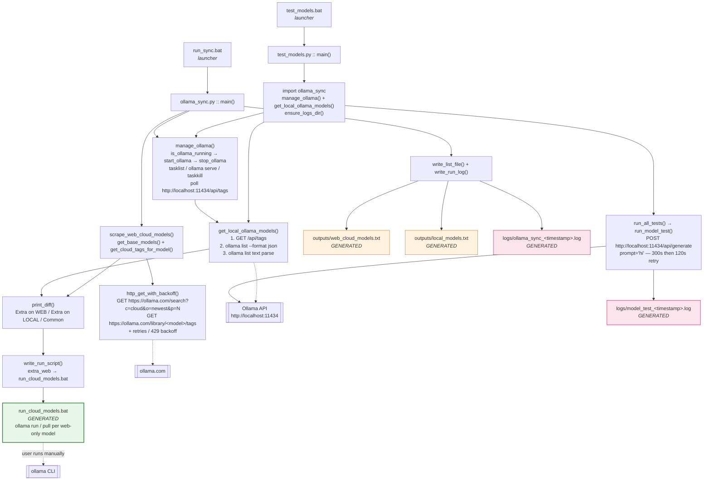

# Ollama Sync

Compare the `:cloud` models listed on [ollama.com](https://ollama.com/search?c=cloud&o=newest)
against the models installed locally on this PC, generate a run script for the web-only
models, and test which installed models actually work — with colour-coded ✓/✗/⚠ results
in the console and a timestamped log of every run.

## Files

| File | Purpose |
| --- | --- |
| `ollama_sync.py` | Main tool: manage Ollama, scrape web `:cloud` models, diff vs local, write log + run script. |
| `test_models.py` | Test every installed model with a `hi` prompt and classify it (functional / needs subscription / retired / not working / unavailable). Colored ✓/✗/⚠ output on the console. |
| `run_sync.bat` | Launcher for `ollama_sync.py` — runs it, lists the log files, and keeps the window open with a key-press. |
| `test_models.bat` | Launcher for `test_models.py` — runs it, lists the log files, and keeps the window open with a key-press. |
| `run_cloud_models.bat` | Generated — one `ollama run <model>` (or `ollama pull` with `--pull-only`) per web-only model. |
| `outputs/web_cloud_models.txt` | Generated — deduplicated sorted list of web `:cloud` models. |
| `outputs/local_models.txt` | Generated — sorted list of local models from `ollama list`. |
| `logs/ollama_sync_<timestamp>.log` | Generated — every sync run writes a log here. |
| `logs/model_test_<timestamp>.log` | Generated — every model test run writes a log here. |

## File call graph



## How the sync works

1. **Manage Ollama** — checks `tasklist` for `ollama.exe` / `ollama app.exe`.
   If not running, starts `ollama serve` and waits until `http://localhost:11434/api/tags`
   responds (up to ~30s). If this script started Ollama, it closes **only that
   instance** (by PID) again when done — other Ollama processes are left alone.
   With `--no-close`, even the instance this script started is left running.
   If Ollama was already running, it is left untouched.
   *(Mirrors `core_value_providers.manage_ollama`.)*
2. **Read local models** — queries the Ollama REST API (`/api/tags`) first
   (most reliable, real size/modified values), falling back to
   `ollama list --format json` and then plain `ollama list` text parsing.
3. **Scrape web cloud models** — fetches `https://ollama.com/search?c=cloud&o=newest`
   and walks the catalog page-by-page (`p=1, 2, …`) until two consecutive pages
   add no new models, collects the `/library/<model>` base models, then visits each
   model's `/library/<model>/tags` page and extracts every tag ending in `cloud`
   (e.g. `glm-5.2:cloud`, `deepseek-v4-flash:0731-cloud`, `gemma4:31b-cloud`).
   If any search or tags page fails, the whole web inventory is reported as
   `FAILED` (a partial crawl is not a complete inventory).
   *(Based on `unified_model_loading.py`; uses the hidden `<input class="command">`
   tag rows with a text-regex fallback, plus retries with exponential backoff and
   HTTP 429 handling.)*
   **No duplicates**: tags are collected into a `set`, cross-model duplicates are
   reported and kept once, and the final list is case-insensitively deduplicated.
4. **Show the difference** — prints:
   - **Extra on WEB** — cloud models not installed locally.
   - **Extra on LOCAL** — local models not on the web cloud list.
   - **Common** — installed locally and on the web.
5. **Write `run_cloud_models.bat`** — one `ollama run <model>` line per
   extra-on-web model (`ollama pull <model>` with `--pull-only`). By default it
   first prints a **PLANNED update** block listing exactly which models will be
   added, then asks for confirmation (`[y/N]`, Enter = No) before overwriting the
   file. Only a `y`/`yes` rewrites it; anything else (or non-interactive stdin)
   leaves the existing script untouched. `--pull-only` skips the prompt and
   regenerates directly, since that is an explicit request.
6. **Write a timestamped run log** to `logs\` containing:
   - **ALL IN WEB** (deduplicated)
   - **ALL IN LOCAL**
   - **NEW IN WEB** (not installed locally)
   - **NEW IN LOCAL** (not on the web cloud list)
   - plus COMMON, an integrity summary (pages scanned, base models found,
     duplicates removed, failed pages, inventory status), summary counts, and a
     line recording whether `run_cloud_models.bat` was updated (`yes`/`no`).

If either inventory **fails** (network error, HTTP failure, a partial page
crawl, or `ollama list` errors), that failure is reported in the console and log
as `FAILED` — never silently treated as an empty list. `--web-only` records the
local side as *skipped* (deliberately not checked), which is also distinct from
*empty*.

## Usage

```bat
run_sync.bat               REM run the sync, then shows the log file(s)
run_sync.bat --web-only    REM skip local Ollama management/list
run_sync.bat --pull-only   REM generate run_cloud_models.bat with `ollama pull`
```

Or directly: `python ollama_sync.py [--web-only] [--no-close] [--pull-only]`

- `--web-only` — skip the local Ollama open/list/close (local side is recorded
  as *skipped* — deliberately not checked — rather than *empty*).
- `--no-close` — keep Ollama running even if this script started it.
- `--pull-only` — generate `run_cloud_models.bat` using `ollama pull` (download
  only) instead of `ollama run` (interactive chat). Skips the confirmation prompt.

Without `--pull-only`, the script lists the web-only models it would add and asks
`Regenerate run_cloud_models.bat with these N web-only model(s)? [y/N] (Enter = No)` —
press `y` to overwrite, or just press Enter / anything else to leave the existing
script as-is.

## Testing models

`test_models.py` sends a `hi` prompt to every installed model via the Ollama API and
classifies the result. Each model gets a generous first attempt (300 s) so a slow
cold-start isn't misclassified as dead; if that times out, it retries once with a
shorter 120 s timeout. The reported elapsed time covers both attempts.

| Status | Symbol / colour | Meaning |
| --- | --- | --- |
| `functional` | ✓ green | Responded normally to `hi`. **Ready to use.** |
| `functional (slow)` | ✓ cyan | Responded, but took > 60s. |
| `needs subscription` | ⚠ yellow | Model exists but requires an Ollama subscription/upgrade (HTTP 401/403). Not usable without upgrading. |
| `retired (410 gone)` | ✗ gray | Model is no longer served by Ollama's cloud (HTTP 410). Not usable. |
| `not working (no response)` | ✗ red | Timed out or returned an empty reply. |
| `not working (error)` | ✗ red | Request failed for another reason. |
| `unavailable (not installed)` | – magenta | Requested via `--only` but not present locally. |

The console output is colour-coded (Windows 10+ cmd): the per-model progress line
shows the symbol + status coloured by result, and the summary counts and grouped
lists use the same colours. Log files are written as plain text (no colour codes)
but mirror the full report: per-model results (status, elapsed, reply snippet,
error), the grouped model lists, and the summary counts.

```bat
test_models.bat                 REM test every installed model
test_models.bat --limit 5       REM only the first 5 models
test_models.bat --only glm-5.2:cloud   REM test a single model
test_models.bat --parallel 3    REM test 3 models concurrently (watch VRAM)
```

`--parallel` above 4 prints a VRAM warning — concurrent large models can
exhaust GPU memory. If the local model inventory cannot be read (`ollama list`
fails), the test script aborts with a clear error and a non-zero exit code
instead of pretending there are zero models.

Each run writes a per-model log under `logs\`. When launched via the `.bat`, the
window stays open until a key is pressed so the report can be read on screen.

## Requirements

- Windows 10/11 (the lifecycle helpers use `tasklist` / `taskkill` /
  `CREATE_NO_WINDOW`; Linux/macOS would need process-control changes)
- Python 3.x
- `requests`, `beautifulsoup4` (`pip install requests beautifulsoup4`)
- Ollama CLI on `PATH`

---

C:\Users\ADMIN>ollama list
NAME                               ID              SIZE    MODIFIED
glm-5.3:cloud                      8477dab3e25b    -       About a minute ago
glm-5.3-flash:cloud                3e780905abc0    -       About a minute ago
deepseek-v4-pro:0813-cloud         47d1ad2bea02    -       About a minute ago
kimi-k3:cloud                      630e737485bd    -       2 weeks ago
gemma4:cloud                       ef09f235533c    -       2 weeks ago
deepseek-v4-flash:preview-cloud    5166728b9358    -       2 weeks ago
deepseek-v4-flash:0731-cloud       d3f1c8744721    -       2 weeks ago
glm-5.2:cloud                      ce8fd6f94793    -       2 months ago
kimi-k2.7-code:cloud               eda07a659237    -       2 months ago
nemotron-3-ultra:cloud             6d55374b63bb    -       2 months ago
minimax-m3:cloud                   d03a959f45c0    -       2 months ago
deepseek-v4-pro:cloud              22bfd5026abd    -       4 months ago
deepseek-v4-flash:cloud            ea027821675c    -       4 months ago
kimi-k2.6:cloud                    a90cd0d1590c    -       4 months ago
glm-5.1:cloud                      59472abf9d0a    -       4 months ago
gemma4:31b-cloud                   c382fbfbc73b    -       4 months ago
minimax-m2.7:cloud                 06daa293c105    -       5 months ago
nemotron-3-super:cloud             be3943c5a818    -       5 months ago
qwen3.5:397b-cloud                 a7bf6f7891c3    -       6 months ago
qwen3.5:cloud                      a7bf6f7891c3    -       6 months ago
minimax-m2.5:cloud                 c0d5751c800f    -       6 months ago
glm-5:cloud                        c313cd065935    -       6 months ago
qwen3-coder-next:cloud             aa626c11ae8d    -       6 months ago
kimi-k2.5:cloud                    6d1c3246c608    -       7 months ago
glm-4.7:cloud                      023608864819    -       8 months ago
minimax-m2.1:cloud                 4ada3a038304    -       8 months ago
gemini-3-flash-preview:latest      ebade0d31690    -       8 months ago
gemini-3-flash-preview:cloud       436200142af2    -       8 months ago
nemotron-3-nano:30b-cloud          01d0d069a149    -       8 months ago
gemini-3-pro-preview:latest        91a1db042ba1    -       8 months ago
rnj-1:8b-cloud                     d8200a2fbf21    -       8 months ago
devstral-small-2:24b-cloud         ec4a591da58a    -       8 months ago
devstral-2:123b-cloud              d37aca5b6a27    -       8 months ago
qwen3-next:80b-cloud               f5ccd68d2872    -       8 months ago
gemma3:27b-cloud                   9e1580299085    -       8 months ago
gemma3:12b-cloud                   485e7119a53a    -       8 months ago
gemma3:4b-cloud                    89c58fea5420    -       8 months ago
deepseek-v3.2:cloud                55f7c48fb187    -       8 months ago
mistral-large-3:675b-cloud         3130fd5a5a1e    -       8 months ago
ministral-3:14b-cloud              615c59440878    -       8 months ago
ministral-3:8b-cloud               a56a5396dfb9    -       8 months ago
ministral-3:3b-cloud               6938c17dead4    -       8 months ago
cogito-2.1:671b-cloud              36c90b0682ed    -       8 months ago
qwen3-vl:235b-instruct-cloud       2bf9522f6961    -       8 months ago
deepseek-v3.1:671b-cloud           d3749919e45f    -       8 months ago
gpt-oss:20b-cloud                  875e8e3a629a    -       8 months ago
glm-4.6:cloud                      05277b76269f    -       8 months ago
kimi-k2-thinking:cloud             9752ffb77f53    -       8 months ago
minimax-m2:cloud                   698ab6d56142    -       8 months ago
qwen3-coder:480b-cloud             e30e45586389    -       8 months ago
kimi-k2:1t-cloud                   20dc43ca06d7    -       8 months ago
qwen3-vl:235b-cloud                86b3322ec200    -       8 months ago
gpt-oss:120b-cloud                 569662207105    -       8 months ago

C:\Users\ADMIN>

---